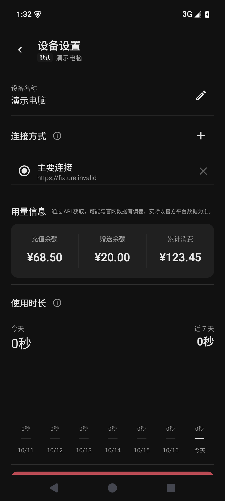
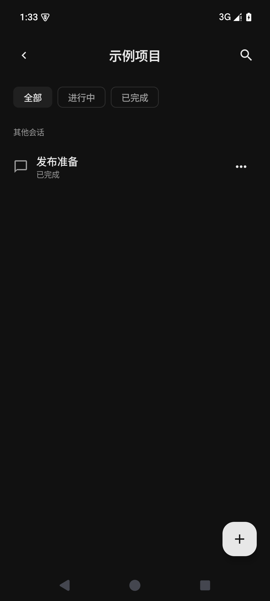
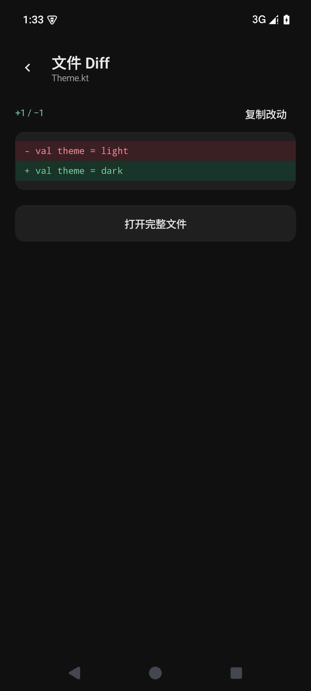
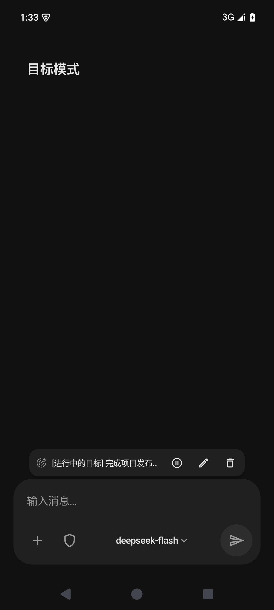
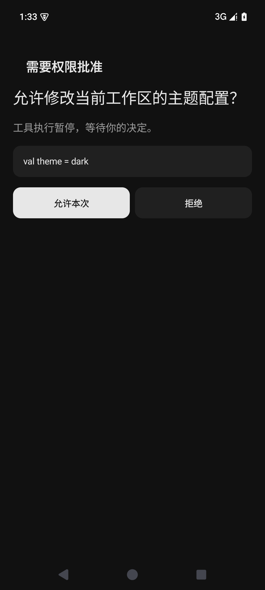
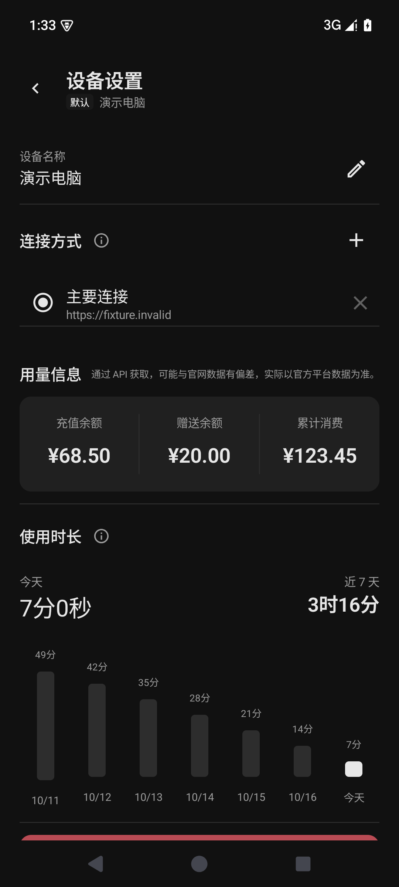
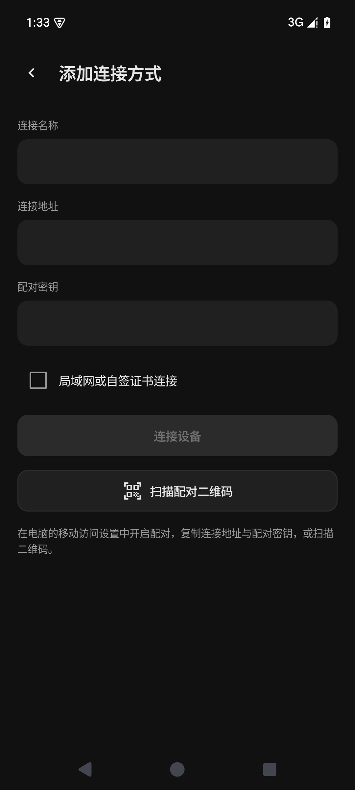
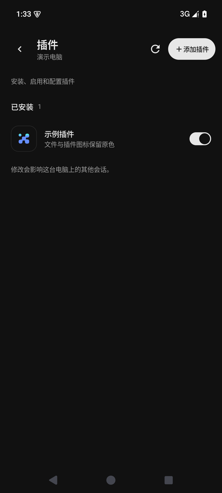
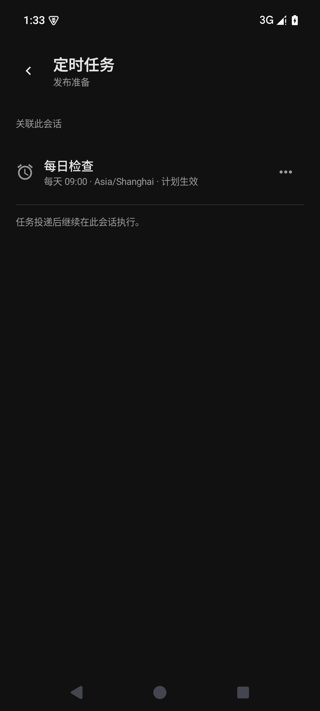
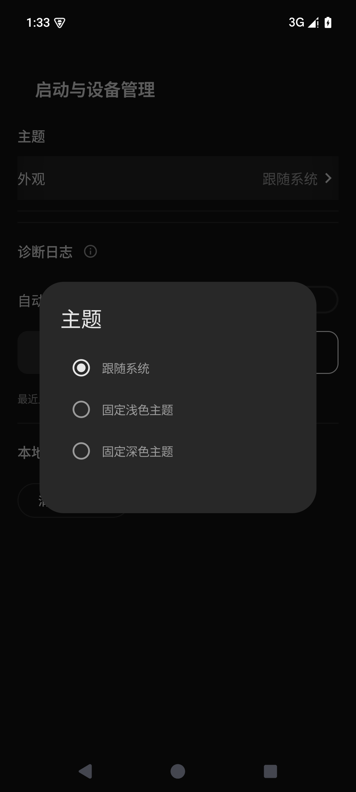

# DSH Mobile App

**把电脑上的 DeepSeek Harness，带到 Android 手机上。**

[下载 Android App](https://github.com/y8n/dsh-mobile-app/releases) · [快速开始](docs/guide/getting-started.md) · [功能与界面](#功能与界面) · [与原项目的区别](#与原项目的区别) · [参与开发](CONTRIBUTING.md)

> **基于 [saya-ch](https://github.com/saya-ch) 的 [dsh-mobile](https://github.com/saya-ch/dsh-mobile) 开发。**
> 感谢原作者及贡献者提供移动访问、配对鉴权和远程连接的基础。本项目保留其电脑端能力，重新构建原生 Android 体验；也感谢 [DeepSeek Harness](https://github.com/deepseek-ai/deepseek-harness) 提供宿主与协议。完整署名见 [CREDITS](CREDITS.md)。

DSH Mobile App 是 DeepSeek Harness 的**非官方原生 Android 客户端**，使用 Kotlin / Jetpack Compose 开发。AI 和工具在电脑上运行，手机连接电脑，继续同一份工作区与会话。

  
  
  

## 下载

前往 **[GitHub Releases 下载 Android App](https://github.com/y8n/dsh-mobile-app/releases)**，查看安装包、更新说明及配套插件要求。Android App 与电脑插件分别发布，兼容边界见[兼容说明](docs/版本兼容说明.md)。

## 功能与界面

### 在手机上继续工作

- **工作区与会话**：浏览、创建、重命名和删除工作区，打开已有会话，切换模型及权限。
- **消息与执行过程**：流式接收回答，查看思考与工具调用；完成后折叠过程，集中阅读最终结果。
- **Markdown 与文件**：表格、代码高亮、复制和折行；打开电脑上的文件链接，查看附件、图片及 diff，保留原 Markdown 链接。
- **插件与任务**：管理电脑插件、选择 npm 安装源，查看和管理 AI 创建的定时任务。

  
  
  

### 为移动使用打磨

- **多设备、多连接**：同一电脑保存多种连接，在家用局域网、在外用隧道，手动快速切换，无需反复添加设备。默认设备打开即进入工作区。
- **需要你时再提醒**：区分回答完成、问题确认、权限申请；点击通知进入对应会话，正在前台阅读的会话不重复提醒。
- **清晰的任务状态**：Git 工作区显示分支；目标栏悬浮在输入框上方，可暂停、编辑或删除；发送结果不确定时可核对恢复。
- **本地偏好与统计**：会话置顶仅在 App 生效；按设备统计前台使用时长，查看近 7 天趋势。
- **主题与用量**：跟随系统、浅色、深色三种主题；设备设置展示充值余额、赠送余额与累计消费。

  
  
  

更多界面：连接、插件、定时任务与主题

  
  
  
  

截图使用原生组件在 Android 模拟器中生成，数据均为虚构演示数据。[截图说明](docs/screenshots/README.md)

## 快速开始

需要一台运行 DeepSeek Harness 的电脑，以及 Android 8.0 或以上的手机。宿主、插件与 App 的配套要求请以所选 Release 的说明为准，功能依赖见[兼容说明](docs/版本兼容说明.md)。

1. **电脑安装插件**：在 DeepSeek Harness 的插件管理中添加 `@dsh-mobile-app/desktop-extension`，选择 npm 官方源；如 Release 指定配套插件版本，请按其说明安装。
2. **配置访问并配对**：在电脑插件中设置局域网或远程访问，打开配对入口；手机添加设备并核对身份与证书。
3. **进入工作区**：打开已有会话即可继续发送消息、查看执行结果和文件。

**电脑只需一个移动访问插件。** 整合包已包含原项目网关能力，已有 `dsh-mobile` 用户请先阅读[迁移步骤](docs/guide/getting-started.md)，保留配对与配置，避免同时启用两个网关。

Android 构建方法见 [CONTRIBUTING](CONTRIBUTING.md)；完整连接步骤见[使用指南](docs/guide/getting-started.md)。

## 与原项目的区别

本项目基于整合时的 dsh-mobile 源码开发，具体来源见 [CREDITS](CREDITS.md)，不将差异描述套用于上游后续更新。原项目已经提供消息、工具、文件、通知与远程连接，本项目在此基础上整合电脑插件，并开发独立的原生移动界面。

- **界面实现**：从原项目 App 的 WebView 网页访问方式，改为 Compose 原生页面；工作区、会话、阅读器和设置均针对手机布局。
- **阅读体验**：紧凑的过程行、最终结果折叠逻辑、代码复制与折行、原生文件与 diff 查看器。
- **设备体验**：在家用局域网、在外用隧道，保存连接后手动快速切换；本地置顶、设备前台使用统计、三种主题与设备用量面板。
- **交互增强**：三类通知、前台会话免打扰、目标浮动栏、Git 分支和发送待确认恢复。

本页截图展示上述原生 UI；[原项目 README](https://github.com/saya-ch/dsh-mobile) 可查看原界面。逐项来源、增强范围及更多界面见[功能对照](docs/guide/enhancements.md)。

## 使用前了解

- **电脑需保持运行且可达**。本 App 不在手机上运行代理；网页侧栏扩展、网页语音等浏览器能力不会自动变成原生功能。
- **后台通知依赖系统许可**。华为等手机需要允许 App 后台运行；进程被系统限制或结束时可能无法及时提醒，不保证系统级推送送达。
- **诊断日志默认仅存本地**。需要排查时可上传到已配对电脑，复用现有连接，不依赖云存储；自动上传需另行开启。参见[日志上传与本地排查](docs/guide/diagnostics.md)和[隐私说明](PRIVACY.md)。
- **用量可能存在偏差**。通过 API 获取，可能与官网数据有偏差，实际以官方平台数据为准。缺少桌面账号凭据时累计消费显示“未知”。

## 参与与反馈

欢迎提交可复现的 [Issue](https://github.com/y8n/dsh-mobile-app/issues) 或 Pull Request。开发环境、测试与提交约定见 [CONTRIBUTING](CONTRIBUTING.md)，其他使用文档见[文档导航](docs/README.md)。请勿在问题或截图中暴露配对密钥、真实连接配置和个人会话；安全问题按 [SECURITY](SECURITY.md) 处理。

## 致谢与许可

特别感谢 **[saya-ch](https://github.com/saya-ch)** 和 **[dsh-mobile](https://github.com/saya-ch/dsh-mobile) 贡献者**，以及 **DeepSeek Harness 贡献者**。没有原项目提供的基础，就没有本项目的移动端整合。

本项目原创代码及修改采用 [Apache-2.0](LICENSE)，第三方部分遵循各自许可。原始署名、许可和修改声明见 [NOTICE](NOTICE)、[CREDITS](CREDITS.md) 和[第三方许可](THIRD_PARTY_NOTICES.md)。本项目不代表原作者或 DeepSeek 官方；源码许可不授予名称、图标或商标的使用权。
