

# DSH Mobile App

**把电脑上的 DeepSeek Harness，带到 Android 手机上。**

[下载 Android App](https://github.com/y8n/dsh-mobile-app/releases) · [快速开始](docs/guide/getting-started.md) · [连接教程](#连接方式与详细教程) · [功能与界面](#功能与界面) · [与原项目的区别](#与原项目的区别) · [参与开发](CONTRIBUTING.md)

> **基于 [saya-ch](https://github.com/saya-ch) 的 [dsh-mobile](https://github.com/saya-ch/dsh-mobile) 开发。**
> 感谢原作者及贡献者提供移动访问、配对鉴权和远程连接的基础。本项目保留其电脑端能力，重新构建原生 Android 体验；也感谢 [DeepSeek Harness](https://github.com/deepseek-ai/deepseek-harness) 提供宿主与协议。完整署名见 [CREDITS](CREDITS.md)。

DSH Mobile App 是 DeepSeek Harness 的**非官方原生 Android 客户端**，使用 Kotlin / Jetpack Compose 开发。AI 和工具在电脑上运行，手机连接电脑，继续同一份工作区与会话。

  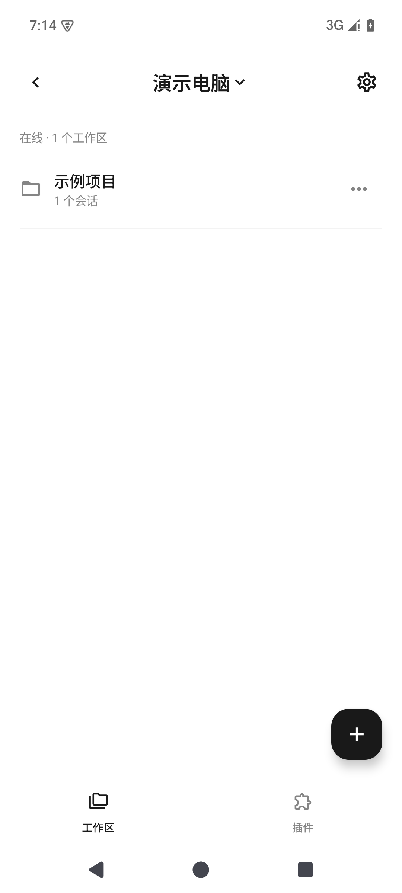
  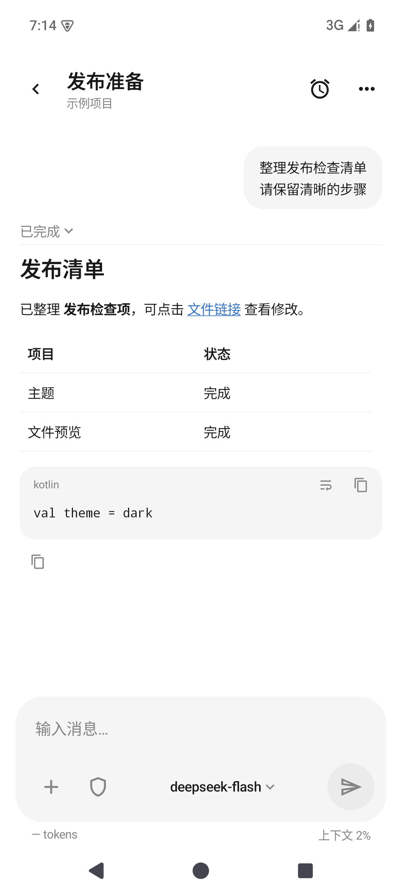
  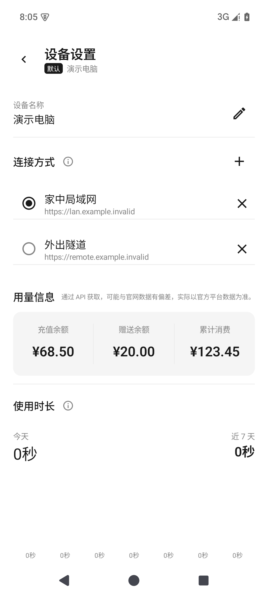

## 下载

前往 **[GitHub Releases 下载 Android App](https://github.com/y8n/dsh-mobile-app/releases)**，查看安装包、更新说明及配套插件要求。Android App 与电脑插件分别发布，兼容边界见[兼容说明](docs/版本兼容说明.md)。

电脑插件正式版 **0.2.1** 可在 DSH 插件管理中通过 npm 官方源安装：`@dsh-mobile-app/desktop-extension@0.2.1`。本次修复新版宿主下的会话列表、电脑日志上传和通知接口；已有 Android 0.2.1 无需更新 APK。升级后重新连接手机即可，详见[插件更新说明](desktop/mobile-extension/CHANGELOG.md)。

## 功能与界面

### 在手机上继续工作

- **工作区与会话**：浏览、创建、重命名和删除工作区，打开已有会话，切换模型及权限。
- **消息与执行过程**：流式接收回答，查看思考与工具调用；完成后折叠过程，集中阅读最终结果。
- **Markdown 与文件**：表格、代码高亮、复制和折行；打开电脑上的文件链接，查看附件、图片及 diff，保留原 Markdown 链接。
- **插件与任务**：管理电脑插件、选择 npm 安装源，查看和管理 AI 创建的定时任务。

  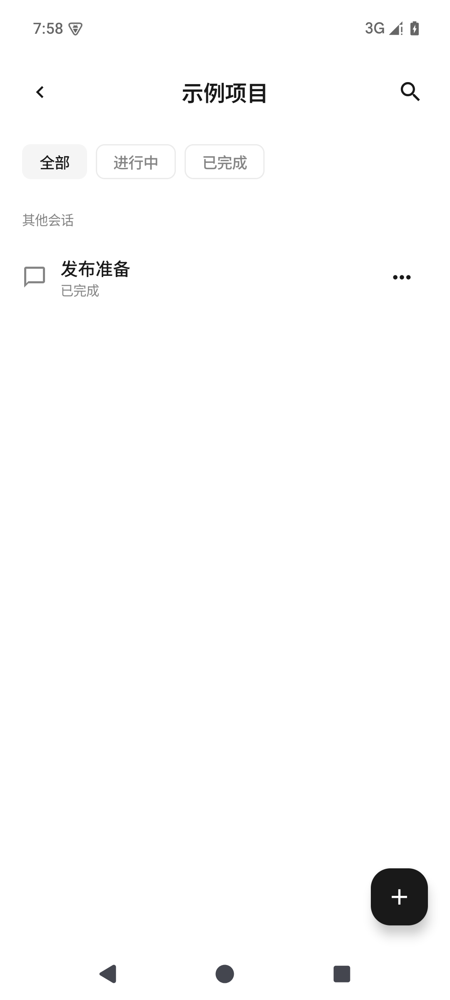
  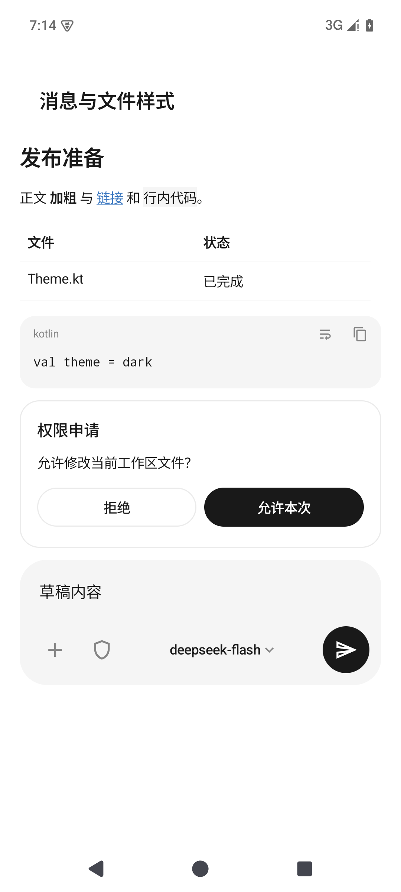
  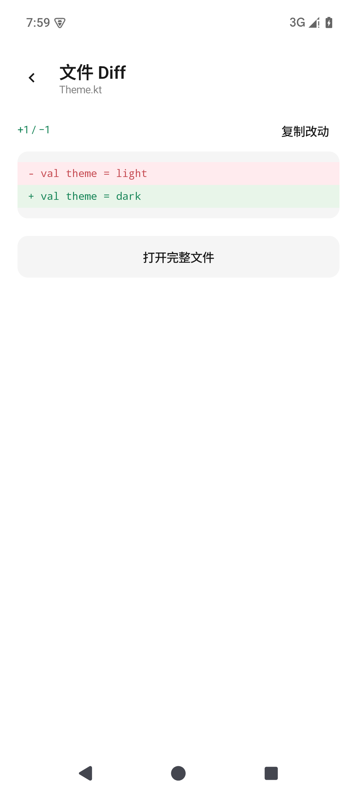

### 为移动使用打磨

- **多设备、多连接**：同一电脑保存多种连接，在家用局域网、在外用隧道，手动快速切换，无需反复添加设备。默认设备打开即进入工作区。
- **需要你时再提醒**：区分回答完成、问题确认、权限申请；点击通知进入对应会话，正在前台阅读的会话不重复提醒。
- **清晰的任务状态**：Git 工作区显示分支；目标栏悬浮在输入框上方，可暂停、编辑或删除；发送结果不确定时可核对恢复。
- **本地偏好与统计**：会话置顶仅在 App 生效；按设备统计前台使用时长，查看近 7 天趋势。
- **主题与用量**：跟随系统、浅色、深色三种主题；设备设置展示充值余额、赠送余额与累计消费。

  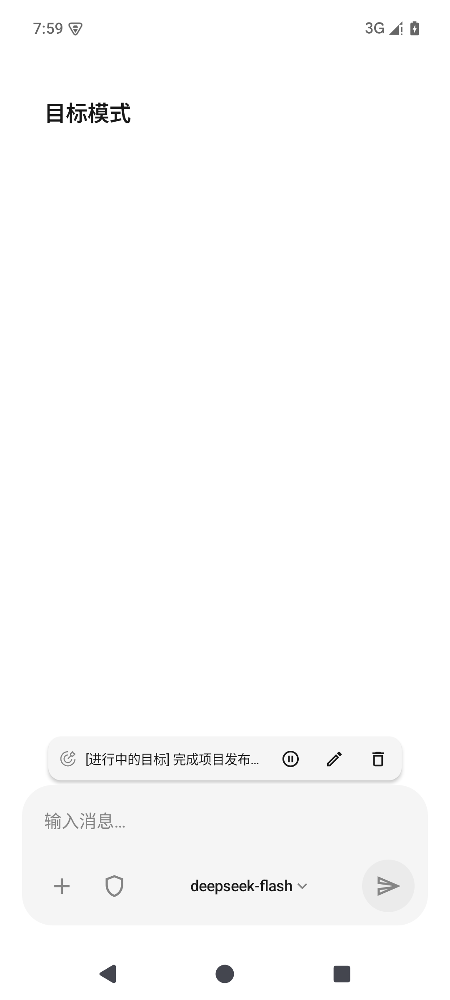
  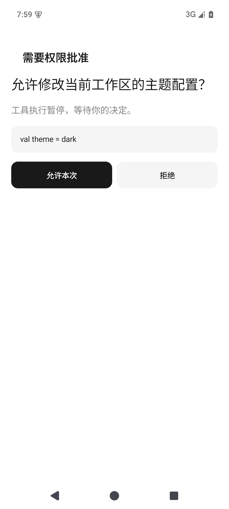
  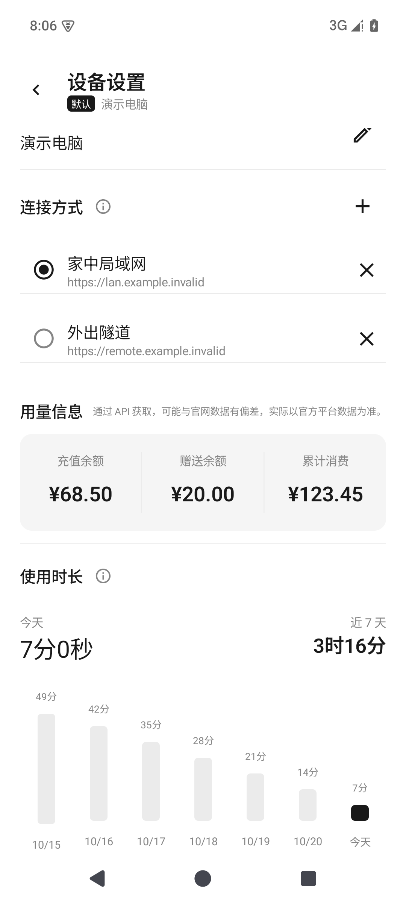

更多界面：连接、插件、定时任务与主题

  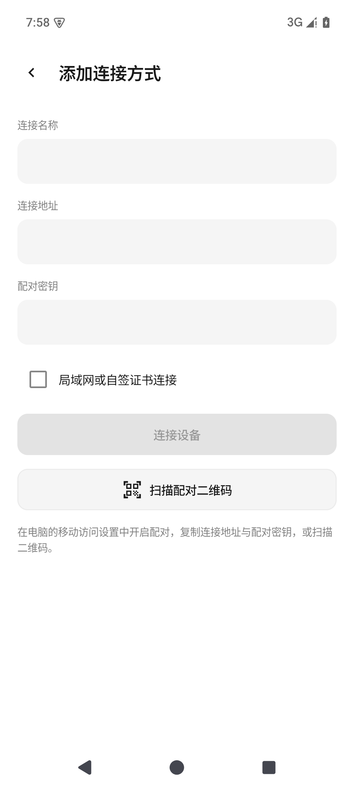
  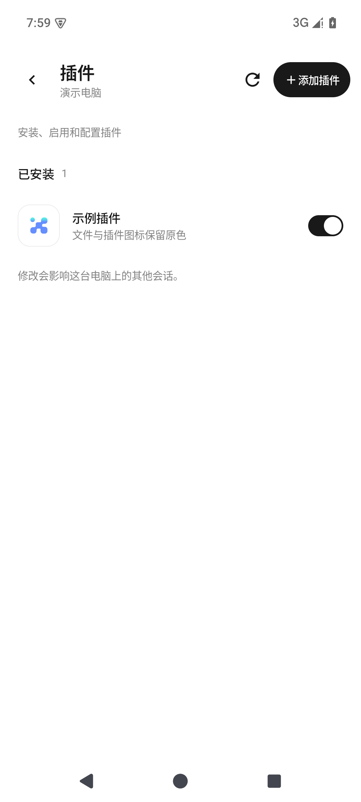
  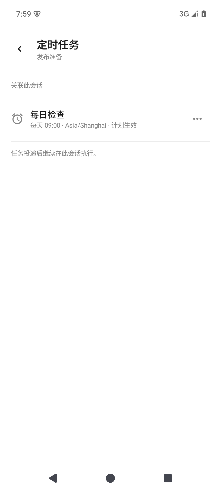
  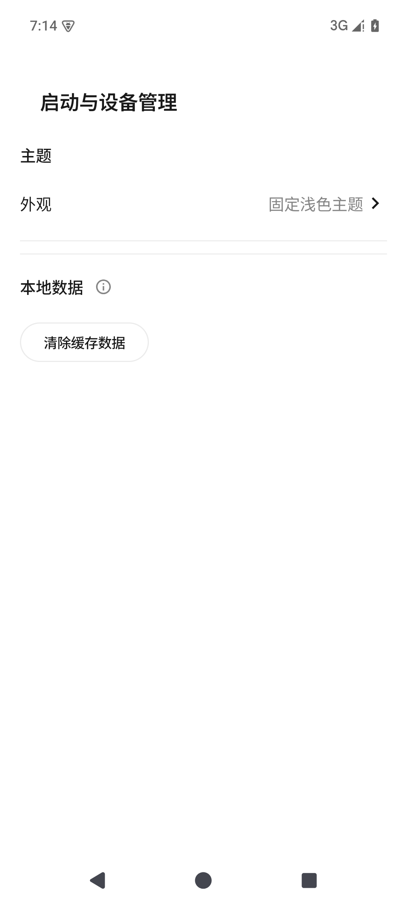
  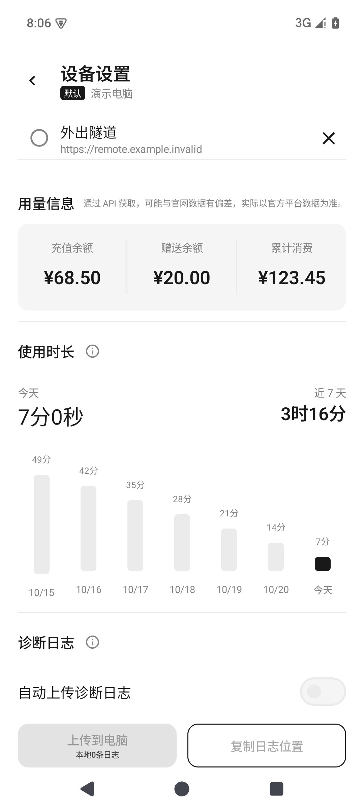
  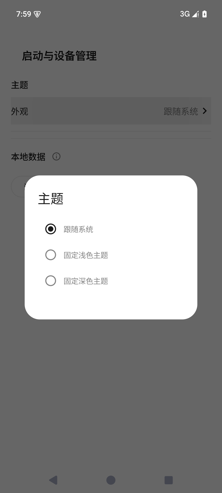

### 浅色与深色主题

默认跟随系统，也可固定选择浅色或深色。以下为同一会话的主题对比。

  
  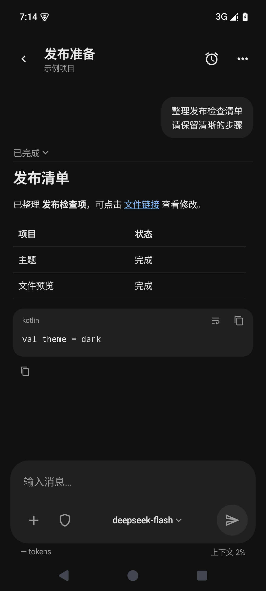

截图使用原生组件在 Android 模拟器中生成，数据均为虚构演示数据。[截图说明](docs/screenshots/README.md)

## 快速开始

需要一台运行 DeepSeek Harness 的电脑，以及 Android 8.0 或以上的手机。宿主、插件与 App 的配套要求请以所选 Release 的说明为准，功能依赖见[兼容说明](docs/版本兼容说明.md)。

1. **电脑安装插件**：在 DeepSeek Harness 的插件管理中添加 `@dsh-mobile-app/desktop-extension`，选择 npm 官方源；如 Release 指定配套插件版本，请按其说明安装。
2. **配置访问并配对**：在电脑插件中设置局域网或远程访问，打开配对入口；手机添加设备并核对身份与证书。
3. **进入工作区**：打开已有会话即可继续发送消息、查看执行结果和文件。

**电脑只需一个移动访问插件。** 整合包已包含原项目网关能力，已有 `dsh-mobile` 用户请先阅读[迁移步骤](docs/guide/getting-started.md)，保留配对与配置，避免同时启用两个网关。

Android 构建方法见 [CONTRIBUTING](CONTRIBUTING.md)；完整连接步骤见[使用指南](docs/guide/getting-started.md)。

## 连接方式与详细教程

**在家用局域网，在外用隧道。** 电脑端连接配置沿用 [saya-ch/dsh-mobile 的连接教程](https://github.com/saya-ch/dsh-mobile#连接教程)，感谢原作者维护详细图文说明。按你的网络环境选择：

| 连接方式 | 使用场景 | 原作者详细教程 |
| --- | --- | --- |
| 局域网 | 手机和电脑在同一 Wi-Fi、以太网或热点内 | [配置步骤](https://github.com/saya-ch/dsh-mobile#局域网访问) |
| cpolar | 通过 cpolar 账号配置外网入口 | [配置步骤](https://github.com/saya-ch/dsh-mobile#远程访问) |
| Cloudflare 快速 / 命名隧道 | 临时入口或使用自己的域名 | [配置步骤](https://github.com/saya-ch/dsh-mobile/blob/main/docs/CLOUDFLARE_TUNNEL.md) |
| Tailscale Funnel | 通过 Tailscale 登录与 Funnel 授权开放入口 | [配置步骤](https://github.com/saya-ch/dsh-mobile#远程访问) |
| 自建 FRP | 使用自己的 VPS 部署远程通道 | [配置步骤](https://github.com/saya-ch/dsh-mobile/blob/main/docs/SELF_HOSTED_FRP.md) |
| 接入已有 frps | 已经有 FRP 服务，希望复用现有部署 | [配置步骤](https://github.com/saya-ch/dsh-mobile/blob/main/docs/ATTACH_EXISTING_FRPS.md) |
| 自有反向代理 | 已经有公开 HTTPS 代理入口 | [配置步骤](https://github.com/saya-ch/dsh-mobile/blob/main/docs/SELF_HOSTED_ORIGIN.md) |

**教程使用范围：** 参考原项目的电脑端网络配置步骤即可。安装的电脑插件仍是本项目的 `@dsh-mobile-app/desktop-extension`，手机也使用本项目 App，不需要再安装原插件或原 App。上游文档可能描述比本项目整合版本更新的能力，请以当前插件面板和[兼容说明](docs/版本兼容说明.md)为准。

电脑端通道就绪后，在本 App 填写该入口的 **HTTPS 地址与配对密钥**。给已有电脑添加另一个通道，在 **设备设置 → 连接方式 → ＋** 中添加；在同一位置手动选择家中局域网或外出隧道。详细步骤见[本 App 首次配对、添加通道与切换指南](docs/guide/getting-started.md#建立手机与电脑的连接)。原 App 的自动发现、扫码及自动连接步骤不直接适用于本 App。

遇到反复重连，可参考原作者的[慢链路排查指南](https://github.com/saya-ch/dsh-mobile/blob/main/docs/SLOW_CONNECTIONS.md)，并按本项目的[诊断日志指南](docs/guide/diagnostics.md)收集手机日志。

## 与原项目的区别

本项目基于 **[saya-ch/dsh-mobile](https://github.com/saya-ch/dsh-mobile)** 开发，感谢原作者及贡献者提供移动访问基础。比较以整合时的源码为准，具体来源见 [CREDITS](CREDITS.md)。原项目已有网关、配对、远程连接，以及网页中的消息、文件和通知能力；以下重点列出本项目的原生实现与增强。

### 1. 原生界面与交互

使用 Kotlin / Jetpack Compose 重建 Android 界面，从原项目的 WebView 网页访问方式改为原生页面。工作区、会话、输入框和设备设置针对手机操作设计；执行过程更紧凑，回答完成后折叠过程，方便阅读结果。

下图从左到右为工作区、会话、设备设置，合并自三张模拟器截图。

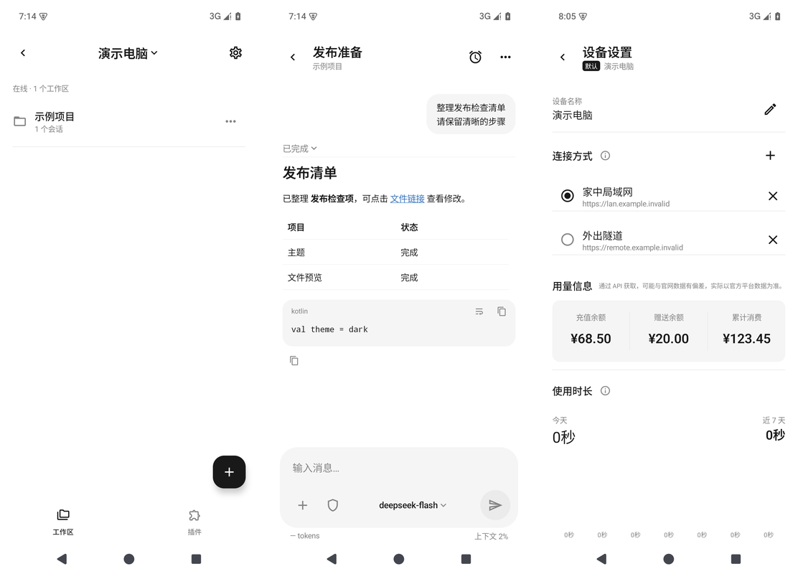

### 2. 原生文件与查看器

在手机上打开电脑文件，使用原生界面查看文件卡片、代码差异和图片。Markdown 中的文件链接由 App 解析并向电脑读取内容，不修改原文档，电脑端仍可照常使用。代码块支持复制和切换折行。

下图从左到右为文件改动列表、diff 查看器、文件类型与图片预览组件。

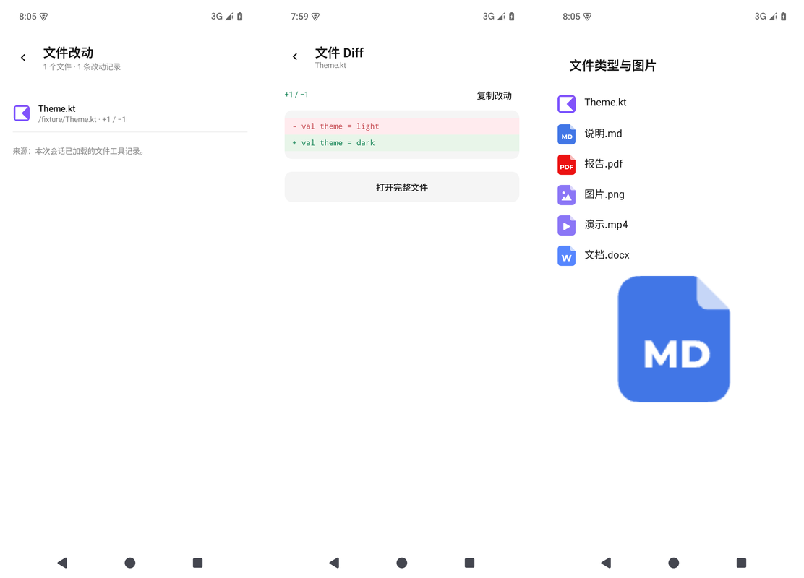

### 3. 多连接通道

同一台电脑可以保存多个连接：**在家用局域网，在外用隧道**，按场景手动切换，不用重复添加设备。连接能力沿用原项目网关，App 增强同一设备下的连接管理，不会自动按优先级切换。

### 4. 设备使用时间

按设备统计 App 在前台使用其页面的时间，展示今天和近 7 天的耗时柱状图，后台运行不计入。数据只保存在手机本地，可在清除缓存时清理。

### 5. 账户余额展示

设备设置中展示充值余额、赠送余额和累计消费。通过 API 获取，可能与官网数据有偏差，实际以官方平台数据为准。累计消费依赖电脑上的桌面账号凭据，无法读取时显示“未知”并提供说明。

### 6. 通知消息

分别提醒 **AI 回答完成、AI 提问确认、权限申请**，使用不同图标与文案，点击通知进入对应会话。正在前台查看该会话时不重复通知。后台送达仍依赖 Android 与厂商的后台权限；华为等设备需要允许后台运行。

以下是模拟器中使用虚构事件生成的系统通知，仅展示通知样式，不代表真机后台送达测试。

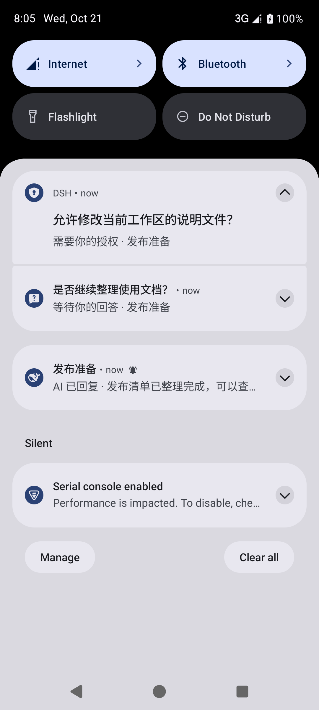

### 7. Git 分支显示与发送待确认恢复

Git 工作区的会话标题下显示当前分支，非 Git 工作区不显示。网络中断导致发送结果不确定时，保留待确认消息，支持核对真实会话及解除待确认后继续操作，避免盲目重复发送。

下图展示会话标题下的 Git 分支；发送待确认是异常恢复能力，不是图中的正常会话状态。

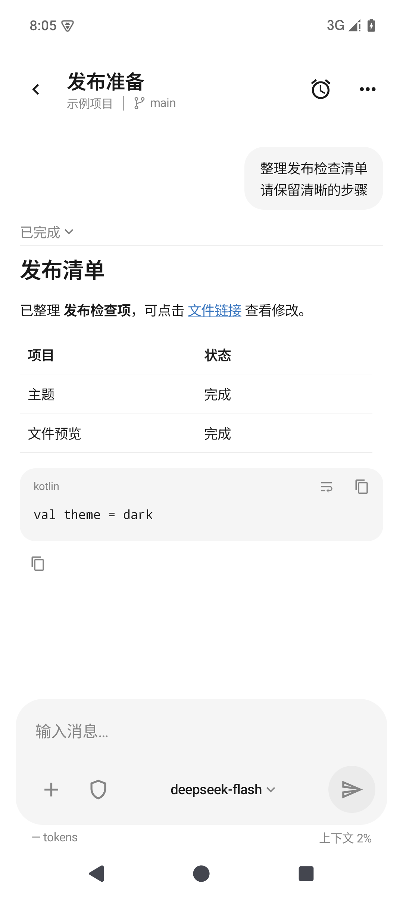

### 8. 日志上传与开发排查

诊断日志默认保存在手机本地。需要排查时，在单个设备的设置中上传到该配对电脑，沿用已有连接与鉴权，日志落在电脑的专用临时目录，不依赖云存储。报告编号和保存位置方便开发者及 AI 定位问题；自动上传需单独开启。

查看[日志上传与本地排查](docs/guide/diagnostics.md)及[逐项功能对照](docs/guide/enhancements.md)。所有截图使用虚构演示数据；[原项目 README](https://github.com/saya-ch/dsh-mobile) 可查看原界面。

## 使用前了解

- **电脑需保持运行且可达**。本 App 不在手机上运行代理；网页侧栏扩展、网页语音等浏览器能力不会自动变成原生功能。
- **后台通知依赖系统许可**。华为等手机需要允许 App 后台运行；进程被系统限制或结束时可能无法及时提醒，不保证系统级推送送达。
- **诊断日志默认仅存本地**。需要排查时可上传到已配对电脑，复用现有连接，不依赖云存储；自动上传需另行开启。参见[日志上传与本地排查](docs/guide/diagnostics.md)和[隐私说明](PRIVACY.md)。
- **用量可能存在偏差**。通过 API 获取，可能与官网数据有偏差，实际以官方平台数据为准。缺少桌面账号凭据时累计消费显示“未知”。

## 参与与反馈

欢迎提交可复现的 [Issue](https://github.com/y8n/dsh-mobile-app/issues) 或 Pull Request。开发环境、测试与提交约定见 [CONTRIBUTING](CONTRIBUTING.md)，其他使用文档见[文档导航](docs/README.md)。请勿在问题或截图中暴露配对密钥、真实连接配置和个人会话；安全问题按 [SECURITY](SECURITY.md) 处理。

## 致谢与许可

特别感谢 **[saya-ch](https://github.com/saya-ch)** 和 **[dsh-mobile](https://github.com/saya-ch/dsh-mobile) 贡献者**，以及 **DeepSeek Harness 贡献者**。没有原项目提供的基础，就没有本项目的移动端整合。

本项目原创代码及修改采用 [Apache-2.0](LICENSE)，第三方部分遵循各自许可。原始署名、许可和修改声明见 [NOTICE](NOTICE)、[CREDITS](CREDITS.md) 和[第三方许可](THIRD_PARTY_NOTICES.md)。本项目不代表原作者或 DeepSeek 官方；源码许可不授予名称、图标或商标的使用权。
